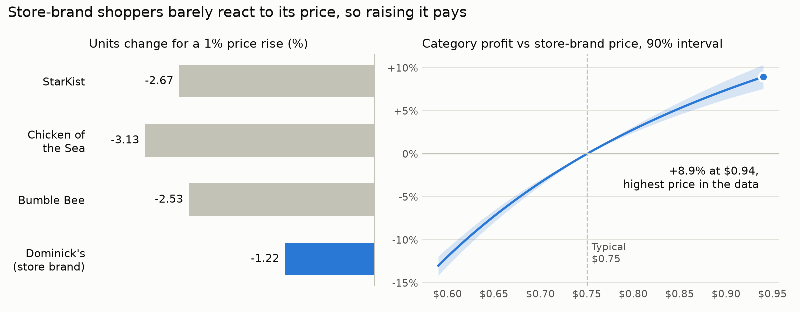

# Is the store brand priced too low? Price elasticity and pricing for canned tuna


**[Try the interactive pricing simulator →](https://francisco-carcano.github.io/retail-price-elasticity/)**

A supermarket chain sells four brands of chunk light canned tuna: three national brands and its own store brand, the cheapest on the shelf. The pricing question: **is the store brand priced right, and what happens to the whole category if it changes?** I estimated how each brand's sales respond to its own price and to its competitors' prices from weekly scanner data covering 93 Chicago stores, then searched for the prices that maximise the category's profit.

## Answer
**The store brand looks underpriced. Raise it, but through a store-group test first.**

- **Store-brand shoppers barely react to its price.** A 1% price rise cuts its units by about 1.2%, against 2.5–3.1% for the national brands.
- **The few who leave move to brands with a better margin.** Raising the store brand from $0.75 to $0.85–0.94 lifts category profit by **about 5–9%** in the model, and the 90% interval stays above zero across that range.
- **The best price sits at the top of the range ever charged ($0.94),** so the model cannot say how far is too far. That makes this a case for a test in a group of stores, not a chain-wide change.
- **The result holds in lower- and higher-income neighbourhoods alike,** so the test can run in any store group. National-brand promotions are a different story: StarKist shoppers are clearly more price-sensitive in lower-income areas.

<picture>
  <source media="(prefers-color-scheme: dark)" srcset="docs/figures/pricing_dark.png">
  
</picture>

## What the model cannot judge
Letting the optimiser move all four prices at once gives +36% category profit with every brand at its highest observed price. I don't treat that as a recommendation:

1. **Much of the price variation in the data comes from temporary promotions.** Shoppers stock up on deals, which a permanent price change does not trigger.
2. **The model only sees switching between brands inside the store,** not shoppers taking their whole basket to a competitor if the category gets expensive.
3. **A cheap staple brings traffic.** The chain probably keeps tuna cheap on purpose, and that value is not in the category's own profit.

These three gaps matter much less when only the store brand moves, because the national brands stay where shoppers expect them.

## How it works
1. **Data.** Dominick's Finer Foods weekly scanner data (1990s): units, shelf price, gross margin and promotion flags per product, store and week. Segment: chunk light tuna in 6–6.5 oz single cans, aggregated to four brands. 109,792 brand × store × week rows, 93 stores, 339 weeks.
2. **Demand model.** For each brand, a log-log regression of units on all four prices, so each coefficient is an elasticity:
   `log(units_i) = store effect + week effect + Σ_j e_ij · log(price_j) + b · promo_share_i`.
   Store effects absorb size and location; week effects absorb seasonality and chain-wide events such as Lent. Standard errors are clustered by week, because prices are set chain-wide each week.
3. **Checks.** The model explains 71–83% of the variation in weekly units. On the last 20% of weeks, held out, it explains 24–52% without knowing those weeks' shocks. Controlling for promotions barely moves the elasticities (store brand −1.11 without, −1.22 with). Tests confirm the estimator recovers known elasticities on simulated data.
4. **Pricing.** Unit cost comes from the margin field. Category profit, `Σ (p_i − c_i) · units_i`, is searched on a price grid **limited to the 5th–95th percentile of prices actually charged**, because a constant-elasticity curve should not be extrapolated.
5. **Uncertainty.** The elasticities are redrawn 1,000 times from their estimated sampling distribution, re-optimising each time, to give 90% intervals.
6. **Income split.** Stores are split at the median income of their trading area and the model is refitted in each half.

Full tables: [`results/pricing.md`](results/pricing.md), [`results/income_segments.md`](results/income_segments.md), [`results/elasticities.json`](results/elasticities.json).

## Elasticity matrix
How the row brand's units change, in %, when the column brand's price rises 1%:

| Units of ↓ / price of → | StarKist | Chicken of the Sea | Bumble Bee | Dominick's |
| --- | --- | --- | --- | --- |
| **StarKist** | **−2.67** | 0.62 | 0.44 | −0.03 |
| **Chicken of the Sea** | 0.63 | **−3.13** | 0.21 | 0.14 |
| **Bumble Bee** | 0.82 | 0.41 | **−2.53** | 0.18 |
| **Dominick's** | 0.24 | −0.05 | 0.16 | **−1.22** |

The national brands compete hard with each other. When the store brand gets more expensive, national-brand sales barely move (the last column). When national brands get cheaper, they take some store-brand sales.

## Limitations
- **Costs are approximate.** The margin field is based on average inventory cost, not replacement cost.
- **The data are from the 1990s and one chain.** The method transfers; the numbers describe that market.
- **Prices are not randomised.** Store and week effects remove the main confounders, but promotions are planned, not random.
- **Profit is per average store-week**, before any test confirms it.

## Run it
Python 3.11+. The data are free to download but licensed for academic research only, so they are not in this repository; the script fetches them from the Kilts Center (about 21 MB).

```bash
pip install -e ".[dev]"
python src/download_data.py        # raw Dominick's tuna files -> data/raw/
python src/build_panel.py          # brand x store x week panel -> data/processed/
python src/demand_model.py         # elasticities -> results/elasticities.json (a few minutes)
python src/optimise_prices.py      # prices and profit -> results/pricing.md
python src/segment_by_income.py    # income split -> results/income_segments.md
python src/export_demo_data.py     # data for the interactive page -> docs/demo_data.json
python docs/make_chart.py          # README chart
pytest                             # 19 tests
```

The pricing steps run from the saved results, so `optimise_prices.py`, `export_demo_data.py`, the chart and the tests work without downloading the data.

## Data credit
Dominick's Finer Foods data courtesy of the James M. Kilts Center for Marketing, University of Chicago Booth School of Business.
